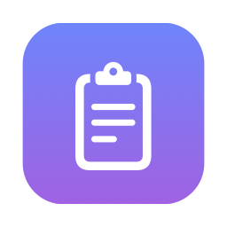
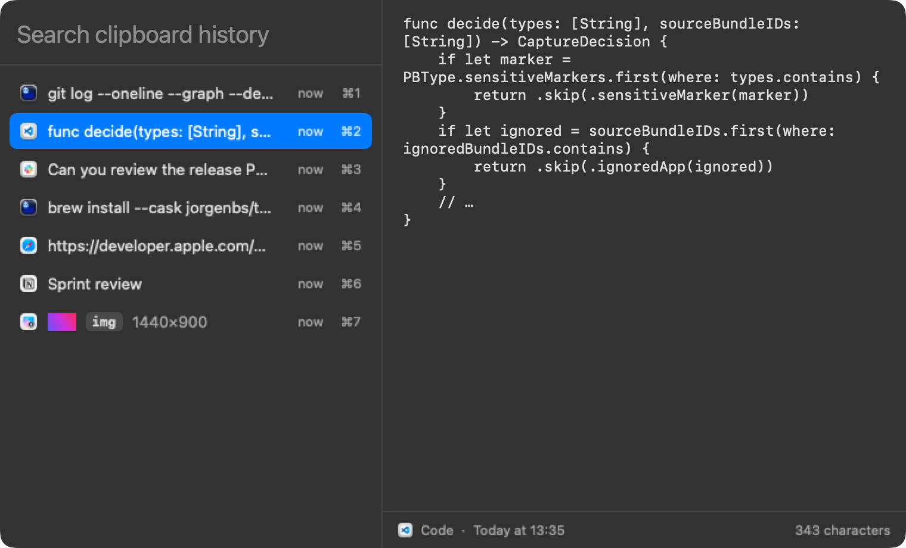
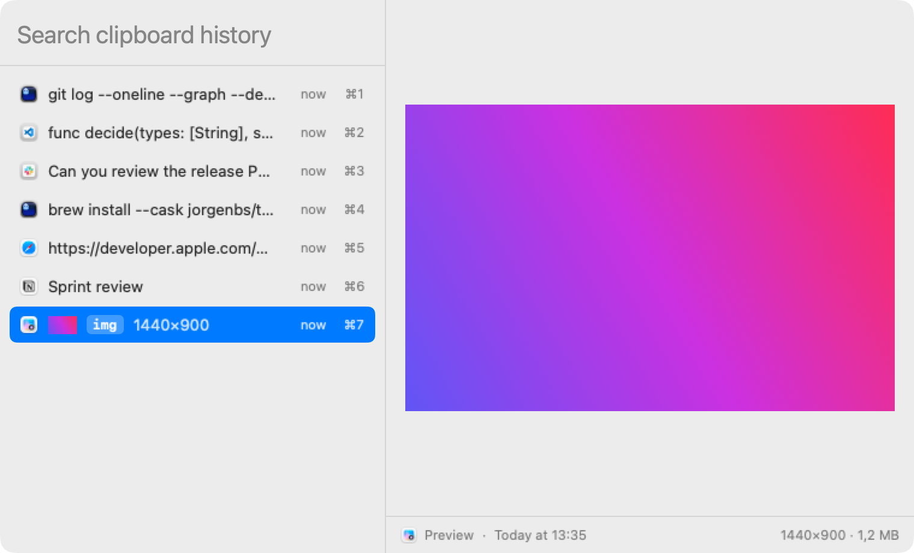

<div align="center">



# Clipboard History

### Everything you copied, one keystroke away.

A tiny menu bar clipboard manager for macOS.<br>
Search as you type. Preview before you paste. Nothing from your password manager.

[](https://github.com/jorgenbs/clipboard-history/releases/latest)
[](https://github.com/jorgenbs/clipboard-history/actions/workflows/ci.yml)


[](https://github.com/jorgenbs/homebrew-tap)

</div>

---

You copied it ten minutes ago. Since then you've copied four other things, and now it's gone.

**Press ⌥⌘C. Type a few letters. Hit Return. It's pasted where you were.**

Clipboard History runs quietly in the menu bar and remembers what you copy: text, rich text, links and images. It deliberately forgets anything that comes from a password manager or is marked as secret.

<p align="center">
  
</p>

## What it does

| | |
| :--- | :--- |
| **Instant overlay** | ⌥⌘C (configurable) opens a floating panel with the search field already focused, so you can start typing right away. |
| **Search + preview** | Clips on the left, a full preview on the right. Long text scrolls, rich text keeps its formatting, and images show at full size. |
| **Auto-paste** | Return pastes into the app you came from. ⌘1–⌘9 paste a row directly. |
| **Private by default** | Skips 1Password, Proton Pass, Passwords, Keychain Access and Wallet. Never records data marked *concealed*, *transient* or *auto-generated* ([nspasteboard.org](http://nspasteboard.org)). |
| **No file clutter** | File copies from Finder are skipped. Images are labelled `img` and shown with a thumbnail. |
| **Menu bar settings** | Change the shortcut, history size (100–5000), ignored apps and launch at login. Pause recording or clear history. |

<p align="center">
  
</p>

## Get it

```sh
brew install --cask jorgenbs/tap/clipboard-history
open "/Applications/Clipboard History.app"
```

**Accessibility (for auto-paste).** On first launch, the app asks for Accessibility access. Turn it on in System Settings › Privacy & Security › Accessibility. Until then, Return copies the clip and you paste with ⌘V yourself.

> [!NOTE]
> The app is **self-signed, not notarized** (no paid Apple Developer account). The cask removes the quarantine flag so it opens without a Gatekeeper prompt. If macOS still blocks it, go to Privacy & Security and click **Open Anyway**. Read the source and build it yourself if you'd rather not trust a binary: it's about 2,000 lines of Swift with no dependencies.

Releases are signed with the same certificate, so the Accessibility grant normally survives upgrades. If auto-paste ever stops working (the app is still listed and switched on, but nothing gets pasted), remove the app from the Accessibility list with **–** and add it again.

## Keys

| Key | Action |
| :--- | :--- |
| ⌥⌘C | Open / close the overlay |
| *type* | Filter clips (text content; images match `img` or the app name) |
| ↑ ↓ · Page Up/Down | Move the selection |
| Return | Paste the selected clip |
| ⌘1 – ⌘9 | Paste that row |
| ⌘⌫ | Delete the selected clip |
| Esc · click outside | Close without pasting |

## Privacy

- History is stored locally in `~/Library/Application Support/ClipboardHistory`. Nothing leaves your Mac.
- By default it keeps the last 500 clips. Images over 10 MB are skipped.
- The app never records copies from ignored apps, or anything marked concealed, transient or auto-generated. Most password managers mark what they copy.
- **Known gap:** a password copied from a *browser extension* is skipped only if the extension marks it as concealed. In that case the frontmost app is the browser, so the ignored-apps list can't catch it.

## Development

Needs Swift 6. Command Line Tools are enough; Xcode is optional.

```sh
swift test                                     # capture filter, store, search
swift build && .build/debug/ClipboardHistory   # run unbundled
UNIVERSAL=0 ./scripts/bundle.sh                # build/Clipboard History.app (ad-hoc signed)
```

- `CLIPBOARD_HISTORY_DATA_DIR=/tmp/ch …` uses a scratch history instead of your real one.
- `--show` opens the overlay on launch.
- Debug builds only: `--demo --snapshot out.png [--dark] [--select n]` renders the overlay with sample clips. That's how the screenshots above are made.

| Path | What |
| :--- | :--- |
| `Sources/ClipboardCore` | AppKit-free logic: `CaptureFilter`, `ClipFactory`, `ClipStore`, `ClipSearch` (unit tested) |
| `Sources/ClipboardHistory` | The app: pasteboard monitor, Carbon hotkey, overlay panel, paste, menu bar, settings |
| `scripts/` | App bundling, signing certificate and cask helpers |

## Releasing

```sh
git tag v0.2.0 && git push origin v0.2.0
```

The `Release` workflow runs the tests, builds a universal (arm64 + x86_64) app, signs it with the self-signed certificate, publishes the zip to GitHub Releases, and updates the cask in [jorgenbs/homebrew-tap](https://github.com/jorgenbs/homebrew-tap).

One-time setup (already done):

- `./scripts/create-signing-cert.sh --set-secrets` creates the certificate and stores it as the `MACOS_SIGNING_CERT_P12` and `MACOS_SIGNING_CERT_PASSWORD` secrets. Back up `signing/`; losing it means everyone re-grants Accessibility once.
- `TAP_DEPLOY_KEY` is a write deploy key on the tap, which CI uses to push cask updates. Without it, the workflow prints the cask in the job summary instead.
